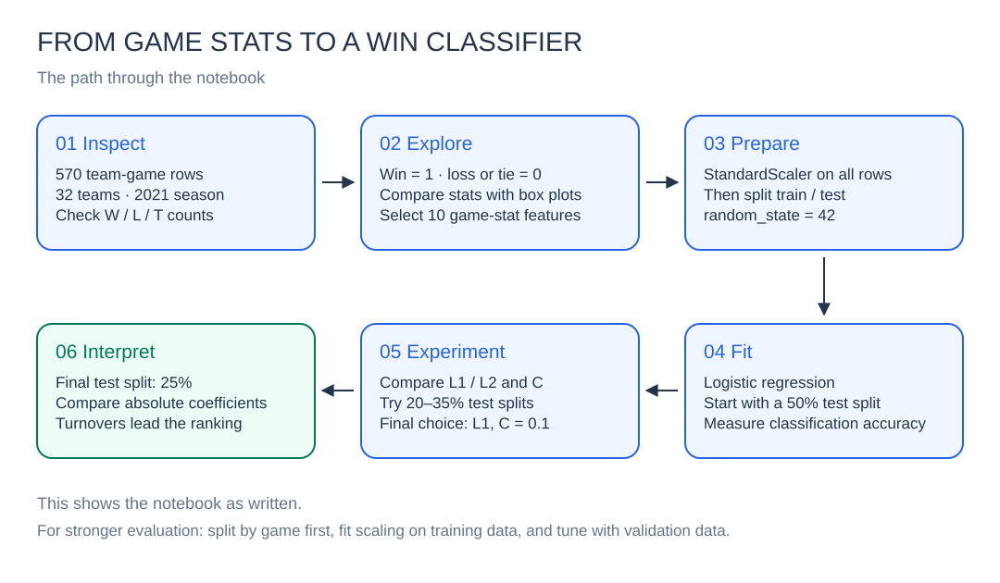
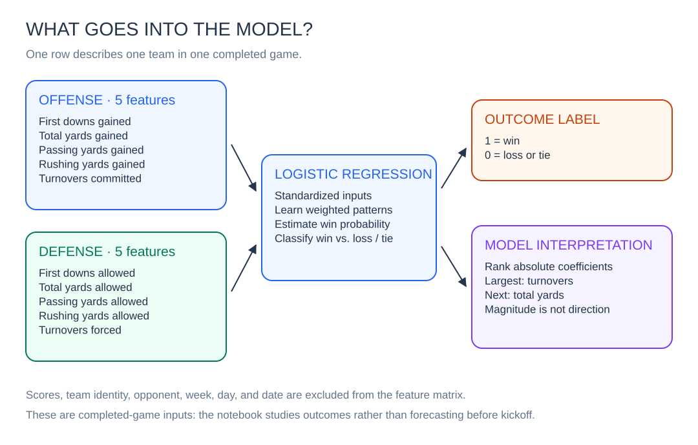

# Analyze NFL Stats with Python

**Goal: understand which offensive and defensive stats are associated with NFL wins, then build an interpretable model that classifies game outcomes.**

This Codecademy case study turns the 2021 NFL season into a practical introduction to data analysis and machine learning. You’ll explore team performance, train a logistic regression classifier, experiment with its settings, and discover which stats carry the most weight in the fitted model.

The central question: **what does a winning game look like in the numbers?**

> The inputs are stats recorded during completed games. This project explains and classifies those outcomes; it does not forecast games before kickoff.

[Get started](#get-started) · [Follow the analysis](#follow-the-analysis) · [Explore the results](#what-the-notebook-found) · [Edit the diagrams](#diagrams)

## The project at a glance

| Item | Details |
| --- | --- |
| Dataset | 2021 season, including playoff games |
| Coverage | 32 teams · 570 team-game rows · 285 games |
| Inputs | 10 offensive and defensive statistics |
| Target | Win (`1`) versus loss or tie (`0`) |
| Model | Logistic regression with standardized features |
| Tools | Python, Jupyter, pandas, NumPy, Matplotlib, Seaborn, scikit-learn |
| Main finding | Turnover stats have the largest absolute coefficients in the final model |

Each game appears twice: once from each team’s perspective. The CSV contains **284 wins, 284 losses, and 2 tie rows**; those two tie rows represent one tied game.

## From the field to the model



The diagram follows the notebook’s current order. The [evaluation notes](#how-to-read-these-results) explain where that learning workflow can be made more rigorous.

## Get started

You’ll need Python 3 and a terminal opened in this project’s folder. The original notebook records Python **3.8.10** in its metadata; dependency versions are not pinned, so package behavior and results may vary between environments.

### 1. Create a virtual environment

```bash
python3 -m venv .venv
```

Activate it on macOS or Linux:

```bash
source .venv/bin/activate
```

On Windows PowerShell:

```powershell
.venv\Scripts\Activate.ps1
```

### 2. Install the notebook tools

```bash
python -m pip install jupyterlab numpy pandas matplotlib seaborn scikit-learn
```

### 3. Open and run the notebook

```bash
python -m jupyter lab Analyze_NFL_Stats_with_Python.ipynb
```

Select the environment’s Python kernel and run the cells from top to bottom. Keep `season_2021.csv` beside the notebook: it is loaded using a relative path.

**First experiment:** change `stat = '1stD_offense'` to `stat = 'TO_offense'` in the box-plot cell. Compare the distribution of turnovers in wins with losses and ties.

## Follow the analysis

| Stage | What you do | What you learn |
| --- | --- | --- |
| **Inspect** | Load the CSV and count outcomes | How the data represents teams, games, and results |
| **Explore** | Encode outcomes and draw box plots | How performance differs between wins and non-wins |
| **Prepare** | Select 10 stats, standardize, and split the data | How features become inputs to a classifier |
| **Train** | Fit logistic regression and measure accuracy | How well a simple model separates the outcomes |
| **Experiment** | Compare regularization and test-set sizes | How model settings and data splits change measured accuracy |
| **Interpret** | Plot absolute model coefficients | Which stats have the largest weights in this fitted model |

The final model is held in memory as `optLr`. The notebook does not export a trained model file.

## What the model sees



The feature matrix uses the final ten CSV columns. Team identity, opponent, scheduling fields, and final scores are excluded.

| Stat family | Offense: what the team produced | Defense: what the team allowed or forced |
| --- | --- | --- |
| First downs | `1stD_offense` — first downs gained | `1stD_defense` — first downs allowed |
| Total yards | `TotYd_offense` — total yards gained | `TotYd_defense` — total yards allowed |
| Passing yards | `PassY_offense` — passing yards gained | `PassY_defense` — passing yards allowed |
| Rushing yards | `RushY_offense` — rushing yards gained | `RushY_defense` — rushing yards allowed |
| Turnovers | `TO_offense` — turnovers committed | `TO_defense` — turnovers forced |

`StandardScaler` puts these features on a comparable scale before fitting the model. Logistic regression learns weights that connect those standardized stats to the likelihood of a win.

## What the notebook found

These figures come from the notebook’s **saved outputs and explanatory text**, rather than a fresh execution.

| Experiment | Settings | Reported accuracy |
| --- | --- | --- |
| Baseline | Default logistic regression · 50% test split | **82.8%** |
| Regularization sweep | L1 · `C = 0.1` · 50% test split | **84.6%** |
| Split-size sweep | L1 · `C = 0.1` · 25% test split | **88.8%** |

All splits use `random_state = 42`. The regularization sweep compares L1 and L2 penalties across `C` values of `0.01`, `0.1`, `1.0`, `10.0`, and `1000.0`; the split-size sweep tries test fractions from 20% to 35%.

**Turnovers stand out.** In the final model’s saved coefficient summary, offensive and defensive turnovers each have an absolute weight of about **0.75**. Total yards follow, with defensive yards at **0.60** and offensive yards at **0.56**.

These are absolute standardized coefficients: they describe weight magnitude, not whether a stat raises or lowers the predicted win probability. They also do not establish cause and effect. Correlated features, such as total yards and its passing/rushing components, can affect how the model distributes its weights.

### How to read these results

The notebook is a useful learning exercise. Its accuracy figures have a few limits:

- **Scaling precedes the split.** The scaler sees all rows, including the future test set. A stronger workflow fits preprocessing on training data only.
- **Rows are split independently.** The two team perspectives from the same game can land in different sets. Splitting by game would keep related observations together.
- **The test set guides model choices.** Selecting hyperparameters and test fractions by their test accuracy makes those scores optimistic. Use validation or cross-validation for selection, followed by a separate final test set.
- **Changing the split changes the experiment.** The 88.8% score uses different training and test sets from the 84.6% score; it is not a comparison on a fixed benchmark.

A useful next iteration would combine a game-level split with a scaler/model pipeline and validation-based tuning, then evaluate once on untouched games.

## Make it your own

Try these small extensions after running the notebook:

1. **Explore a different stat.** Swap the box-plot variable and explain the pattern you see.
2. **Read the mistakes.** Add a confusion matrix to see which outcomes the classifier misses.
3. **Recover direction.** Plot signed coefficients alongside absolute weights.
4. **Test another season.** Prepare a separate dataset with the same feature definitions and order, and transform it with the fitted scaler.

The notebook’s closing text mentions a 2022 example and a `get_new_data()` helper, but neither the helper nor the example code is included in this repository. Its introductory links to `solution.html` and `unguided.ipynb` also refer to files that are not bundled here.

## Repository guide

```text
.
├── README.md                           # Project overview and walkthrough
├── Analyze_NFL_Stats_with_Python.ipynb  # Guided analysis and saved outputs
├── season_2021.csv                     # Local season dataset
└── docs/
    └── diagrams/
        ├── analysis-workflow.excalidraw # Editable analysis workflow
        ├── analysis-workflow.svg        # README preview
        ├── model-map.excalidraw         # Editable model inputs and outputs
        └── model-map.svg                # README preview
```

## Diagrams

Both diagrams include an editable Excalidraw scene and an SVG preview that displays directly in this README.

| Diagram | Editable source | Preview |
| --- | --- | --- |
| Analysis workflow | [Open source](docs/diagrams/analysis-workflow.excalidraw) | [View SVG](docs/diagrams/analysis-workflow.svg) |
| Model inputs and outputs | [Open source](docs/diagrams/model-map.excalidraw) | [View SVG](docs/diagrams/model-map.svg) |

To edit, open [Excalidraw](https://excalidraw.com), load or drag in a `.excalidraw` file, and adjust the shapes or text. Export the updated scene as SVG and replace the matching preview to keep the README in sync.

## Credits

Based on Codecademy’s **Analyze NFL Stats with Python** case study. The original notebook includes the course resource links and guided explanations; the analysis uses the CSV bundled in this repository.
